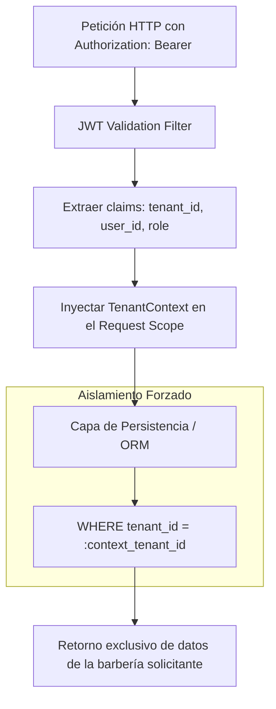
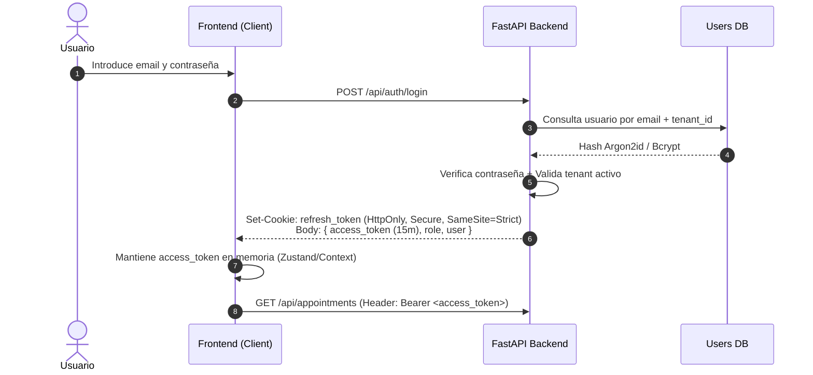
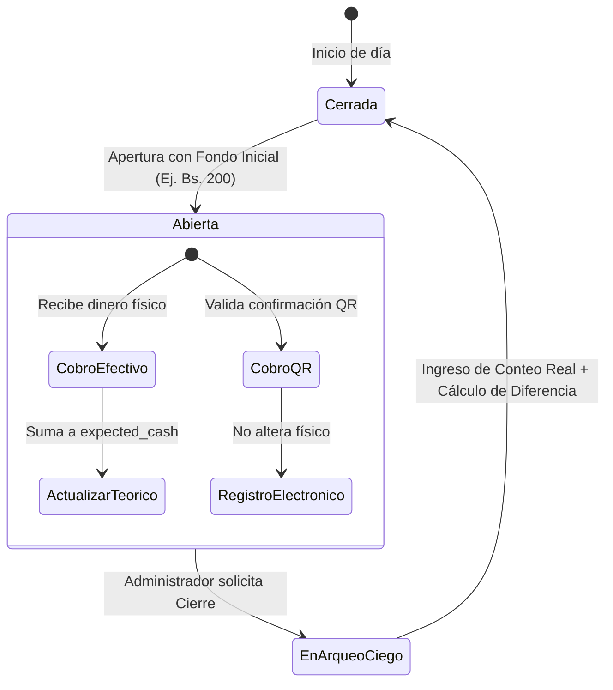
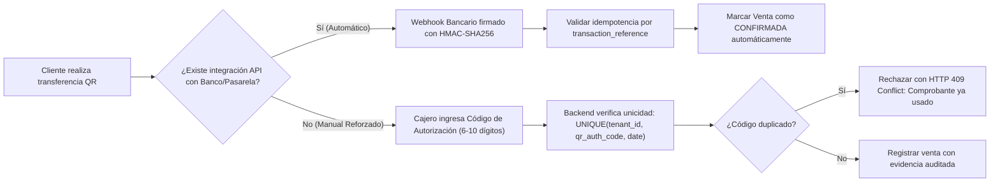
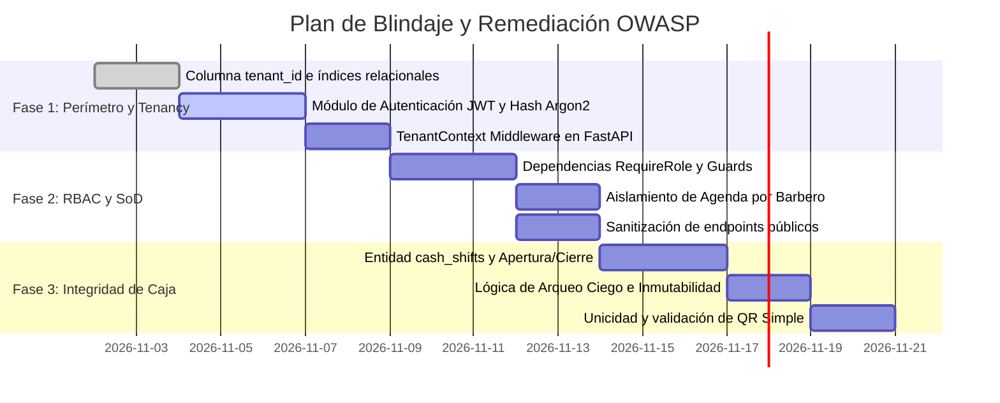

# Auditoría de Seguridad OWASP: SaaS Multi-Tenant para Barberías
**Sistema Evaluado:** ApoloDigital Barber (Plataforma SaaS de Agendamiento, POS y Gestión)  
**Marco de Referencia:** OWASP Top 10 API Security (2023), OWASP ASVS v4.0, NIST SP 800-53 (AC-6 Least Privilege & SoD)  
**Perfil de Auditoría:** Seguridad Ofensiva/Defensiva, Aislamiento de Organizaciones y Prevención de Fraude Financiero  
**Fecha:** 2 de Noviembre de 2026  
**Clasificación:** Confidencial / Arquitectura de Seguridad  

---

## 1. Resumen Ejecutivo y Matriz de Riesgo

El presente dictamen evalúa la arquitectura técnica, modelo de datos y ciclo transaccional de **ApoloDigital Barber** frente a los vectores de amenaza típicos de plataformas SaaS multi-empresa. 

Para operar en un entorno comercial donde coexisten múltiples barberías, franquicias o sucursales, el sistema debe garantizar la estricta **inviolabilidad de los límites organizacionales**, la **imposibilidad de fraude interno por colusión** y la **integridad matemática de los cobros en efectivo y transferencias QR**.

### Matriz de Hallazgos y Severidad

| Dominio Evaluado | Vulnerabilidad / Debilidad Detectada | Severidad OWASP | Impacto en el Negocio |
| :--- | :--- | :---: | :--- |
| **Aislamiento Multi-Tenant** | Falta de `tenant_id` obligatorio en tablas relacionales (Riesgo BOLA). | 🔴 **CRÍTICO** | Fuga masiva de clientes, citas y facturación entre distintas barberías. |
| **Autenticación (JWT)** | Ausencia de firma criptográfica y claims de contexto (`sub`, `org_id`). | 🔴 **CRÍTICO** | Suplantación total de identidad de usuarios y administradores. |
| **Segregación de Funciones (SoD)** | Barberos capaces de cobrar en caja o manipular el estado de sus citas sin testigo. | 🟠 **ALTO** | Fuga de efectivo (cobro directo no registrado) y canibalización de caja. |
| **Comprobantes QR Simple** | Inexistencia de validación cruzada de códigos de autorización o webhook bancario. | 🟠 **ALTO** | Aceptación de capturas de pantalla falsificadas o reutilizadas. |
| **Arqueo y Cierre de Caja** | Cierre no estructurado; falta de sesión de turno y recuento ciego de efectivo. | 🟠 **ALTO** | Imposibilidad de auditar descuadres, faltantes de caja y comisiones reales. |
| **Minimización de Datos (PII)** | Exposición de teléfonos y notas internas en endpoints accesibles públicamente. | 🟡 **MEDIO** | Violación de privacidad del cliente e ingeniería social. |

---

## 2. Aislamiento de Organizaciones (Multi-Tenancy Isolation)

### 2.1 Análisis de Vulnerabilidad (OWASP API1:2023 - Broken Object Level Authorization)
El modelo de base de datos actual opera en una estructura mono-empresa. Si la API se expone a múltiples clientes SaaS sin un aislamiento estricto a nivel de consulta:
* Un usuario autenticado en la *Barbería "Alpha"* podría manipular los parámetros `id` o `barber_id` en `GET /api/appointments?date=...` y extraer las agendas, teléfonos y facturación de la *Barbería "Omega"*.
* Un barbero reasignado podría inyectar registros de citas en calendarios de otra organización.

### 2.2 Arquitectura de Aislamiento Defensivo Requerida



#### Reglas Obligatorias de Implementación:
1. **Esquema Relacional Particionado Lógicamente:**
   Todas las tablas maestras y transaccionales (`services`, `barbers`, `clients`, `appointments`, `sales`, `cash_shifts`) **deben** incorporar la columna `tenant_id TEXT NOT NULL` indexada:
   ```sql
   CREATE INDEX idx_appointments_tenant_date ON appointments(tenant_id, date);
   CREATE INDEX idx_sales_tenant_date ON sales(tenant_id, created_at);
   ```
2. **Prohibición de `tenant_id` en el Cuerpo o Parámetros:**
   El frontend **nunca** debe enviar el `tenant_id` como parámetro manual en formularios o URLs. El `tenant_id` debe derivarse **exclusivamente del JWT validado criptográficamente en el servidor**.
3. **Control de Fuga IDOR en Creación y Consulta:**
   Al crear un registro (ej. una cita), el backend debe forzar:
   ```python
   appointment.tenant_id = current_tenant.id
   ```
   Si el `barber_id` o `service_id` especificados no pertenecen al `current_tenant.id`, la solicitud debe ser rechazada con código `404 Not Found` (o `403 Forbidden` neutro para evitar enumeración).

---

## 3. Autenticación y Arquitectura JWT

### 3.1 Estándar de Token Criptográfico (OWASP API2:2023)
Se prohíbe el uso de tokens con estado expuesto o almacenamiento en `localStorage` del navegador.



### 3.2 Estructura del Payload del Access Token
```json
{
  "iss": "https://api.apolodigital.lat",
  "sub": "usr_7f8a9b1c",
  "org_id": "org_apolobarber_sopocachi",
  "role": "barber",
  "barber_id": "bar_002",
  "permissions": [
    "appointments:read_assigned",
    "appointments:set_in_chair"
  ],
  "iat": 1793650000,
  "exp": 1793650900,
  "jti": "d3b07384-d113-4c9f-9a99-90d0b60f1b2b"
}
```

### 3.3 Controles de Seguridad de Tokens:
* **Firma Fuerte:** Algoritmo **HS256** con llave de mínimo 256 bits derivada de variables de entorno de producción, o **RS256** (par asimétrico público/privado).
* **Mitigación de Algoritmo `none`:** La biblioteca de verificación debe declarar explícitamente `algorithms=["HS256"]` para evitar la falsificación de firmas vacías.
* **Rotación y Revocación:** El `refresh_token` se invalida automáticamente en la base de datos ante el cierre de sesión voluntario o cambio forzado de credenciales.

---

## 4. Matriz RBAC y Segregación de Funciones (SoD)

### 4.1 Definición Semántica de Roles

1. **Dueño (Owner):**  
   Titular de la suscripción SaaS. Posee atribuciones totales sobre auditoría contable, tarifas de suscripción, configuraciones de comisiones de personal, creación de sucursales y reportes ejecutivos.
2. **Administrador (Manager / Recepcionista):**  
   Responsable del funcionamiento operativo diario. Atiende a clientes, coordina agendas, ejecuta aperturas y cierres de caja física y realiza cobros (POS). **No puede** modificar comisiones contractuales ni anular registros consolidados sin huella de auditoría.
3. **Barbero (Staff Operativo):**  
   Profesional técnico. Gestiona el ciclo de su servicio directo en el sillón. **No tiene acceso** a la caja de efectivo general, ni a métricas de facturación de otros profesionales, ni a información confidencial de clientes no asignados.
4. **Cliente (Customer / Público):**  
   Consumidor final. Solo puede consultar bloques de disponibilidad libre (sin nombres de otros clientes) y reservar su propia cita proporcionando datos mínimos de contacto.

---

### 4.2 Matriz de Privilegios y Endpoints (RBAC)

| Módulo | Endpoint / Acción | Cliente | Barbero | Administrador | Dueño |
| :--- | :--- | :---: | :---: | :---: | :---: |
| **Disponibilidad** | `GET /api/appointments/availability` | ✅ | ✅ | ✅ | ✅ |
| **Reservas** | `POST /api/appointments` | ✅ (Propia) | ✅ (Asignada) | ✅ (Cualquiera) | ✅ (Cualquiera) |
| **Agenda Completa**| `GET /api/appointments` | ❌ | ❌ *(Solo sus citas)* | ✅ | ✅ |
| **Estado de Cita** | `PATCH /api/appointments/{id}/status` | ❌ *(Solo cancelar)*| ⚠️ *(En sillón / Terminado)*| ✅ | ✅ |
| **Catálogo Precios**| `POST/PUT/DELETE /api/services` | ❌ | ❌ | ❌ *(Solo lectura)* | ✅ |
| **Comisiones** | Modificar porcentaje de comisión de barberos | ❌ | ❌ | ❌ | ✅ |
| **Checkout (Cobro)**| `POST /api/checkout` | ❌ | ❌ *(Violación SoD)*| ✅ | ✅ |
| **Turno de Caja** | Apertura / Cierre de Turno (`cash_shifts`) | ❌ | ❌ | ✅ | ✅ |
| **Dashboard** | Métricas consolidadas de ingresos y ganancias | ❌ | ❌ | ⚠️ *(Ventas turno)* | ✅ *(Total y márgenes)*|
| **Auditoría** | Visualización de Logs y cambios de precios | ❌ | ❌ | ❌ | ✅ |

---

### 4.3 Puntos Críticos de Segregación de Funciones (Anti-Fraude SoD)

```
[RIESGO DE COLUSIÓN INTERNA #1]: El Barbero cobra directamente al cliente
  Escenario: El cliente paga en efectivo. El barbero recibe el dinero en mano y marca
             la cita en el sistema como "No asistió" o "Cancelada". El barbero se queda con
             el 100% del efectivo y la barbería asume la pérdida.
  CONTROL SoD: 
  1. El barbero no posee botón de "Cobrar" en su interfaz.
  2. La cita solo puede marcarse como 'completada' si existe un registro de venta enlazado
     emitido por el Administrador/Caja.
  3. Las cancelaciones de última hora disparan una notificación en tiempo real a recepción.
```

```
[RIESGO DE COLUSIÓN INTERNA #2]: El Administrador altera precios de liquidación
  Escenario: El administrador edita el precio del servicio o el porcentaje del barbero antes
             de calcular las comisiones a fin de mes.
  CONTROL SoD: 
  1. La tabla 'sales' congela 'service_price_snapshot', 'commission_percentage_snapshot' 
     y 'commission_amount' en el instante exacto del cobro (ya implementado en el backend).
  2. El Administrador carece de permisos para alterar las tasas maestras en la tabla 'barbers'.
```

---

## 5. Transacciones de Caja y Cierre Ciego (Blind Cash Count)

### 5.1 Ciclo de Vida de una Sesión de Caja (`cash_shifts`)

Un sistema de cobros confiable no permite transacciones "huérfanas". Toda venta debe estar obligatoriamente vinculada a una sesión o turno de caja abierto:



### 5.2 Estructura Relacional del Turno de Caja
```sql
CREATE TABLE cash_shifts (
    id TEXT PRIMARY KEY,
    tenant_id TEXT NOT NULL,
    opened_by_user_id TEXT NOT NULL,
    opened_at TEXT NOT NULL,
    initial_cash REAL NOT NULL DEFAULT 0.0,
    
    closed_by_user_id TEXT,
    closed_at TEXT,
    status TEXT NOT NULL DEFAULT 'open', -- 'open' | 'closed'
    
    -- Valores calculados automáticamente por el sistema
    system_cash_sales REAL DEFAULT 0.0,
    system_qr_sales REAL DEFAULT 0.0,
    system_total_sales REAL DEFAULT 0.0,
    expected_cash_in_drawer REAL DEFAULT 0.0, -- initial_cash + system_cash_sales
    
    -- Arqueo ciego introducido por el cajero
    actual_cash_counted REAL DEFAULT 0.0,
    difference REAL DEFAULT 0.0, -- actual_cash_counted - expected_cash_in_drawer
    
    notes TEXT,
    FOREIGN KEY(tenant_id) REFERENCES organizations(id)
);
```

### 5.3 Metodología de "Arqueo Ciego" (Blind Reconciliation)
1. **Ocultamiento del Saldo Teórico:** Al pulsar "Cerrar Caja", la UI del Administrador **jamás debe mostrar** cuánto dinero en efectivo calculó el sistema que debería haber.
2. **Conteo Físico Obligatorio:** El Administrador debe contar los billetes y monedas físicos en la gaveta e introducir el valor: `actual_cash_counted: 1450.00`.
3. **Cálculo y Dictamen Inmediato:** El servidor procesa:
   $$\text{Diferencia} = \text{Efectivo Contado} - (\text{Fondo Fijo} + \sum \text{Ventas Efectivo})$$
   * Si $\text{Diferencia} = 0$: Arqueo exacto.
   * Si $\text{Diferencia} < 0$: Faltante de caja (alerta automática al Dueño).
   * Si $\text{Diferencia} > 0$: Sobrante de caja (posible venta no registrada).
4. **Bloqueo Inmutable:** Una vez cerrada la sesión, la base de datos rechaza cualquier inserción, modificación o anulación retroactiva que tenga fecha de ese turno.

---

## 6. Comprobantes QR Simple (Bolivia) y Prevención de Falsificación

### 6.1 Vectores de Fraude en Pagos QR
En el ecosistema financiero boliviano (QR Simple BCP, Banco Sol, BNB, Banco Unión), existen dos vectores habituales de estafa:
1. **Comprobante Falso Generado por Software:** El cliente muestra una imagen editada en tiempo real con el logo del banco, tipografía idéntica y el monto exacto, pero sin transferencia efectiva.
2. **Reutilización de Comprobante Legítimo:** El cliente o un empleado utiliza el comprobante de una transacción de hace horas o días anteriores para justificar un nuevo servicio.

### 6.2 Estrategia Defensiva en Dos Fases



#### Controles Mandatorios para el Backend:
* **Índice de Unicidad Transaccional:**
  ```sql
  CREATE UNIQUE INDEX idx_unique_qr_reference 
  ON sales(tenant_id, qr_reference_code) 
  WHERE payment_method = 'qr_simple';
  ```
* **Ventana de Tolerancia Temporal:** La fecha y hora que acompañan al comprobante QR no pueden tener una antigüedad mayor a 20 minutos respecto al momento del cobro.

---

## 7. Plan de Remediación e Implementación Priorizado



### Lista de Entregables por Etapa

#### Etapa 1: Blindaje Perimetral (Inmediato)
- [ ] Incorporación de `tenant_id` en todas las tablas relacionales.
- [ ] Implementación de `auth.py` con `/api/auth/login` y verificación de contraseñas.
- [ ] Inyección de `TenantContext` en cada endpoint autenticado.

#### Etapa 2: Control de Acceso y Segregación (Estructural)
- [ ] Creación de decoradores `RequireRole(["owner", "admin"])` en FastAPI.
- [ ] Restricción de vista de agenda: los barberos solo reciben citas donde `barber_id == current_user.barber_id`.
- [ ] Minimización de datos en la vista pública: eliminar teléfonos y notas del retorno de disponibilidad.

#### Etapa 3: Integridad Financiera y Cobros (Contable)
- [ ] Implementación del módulo de turnos de caja (`/api/cash/open`, `/api/cash/close`).
- [ ] Formulario de cierre ciego en frontend con cálculo de descuadre en backend.
- [ ] Validación de código de autorización y no-repudio en transacciones con QR Simple.

---

**Dictamen del Auditor:**  
La implementación de las directrices expresadas en este documento elevará la solución de un prototipo operativo funcional a una plataforma SaaS con certificación de seguridad de grado industrial, garantizando la privacidad de los datos de cada barbería y protegiendo a los propietarios contra fraudes internos de caja.
